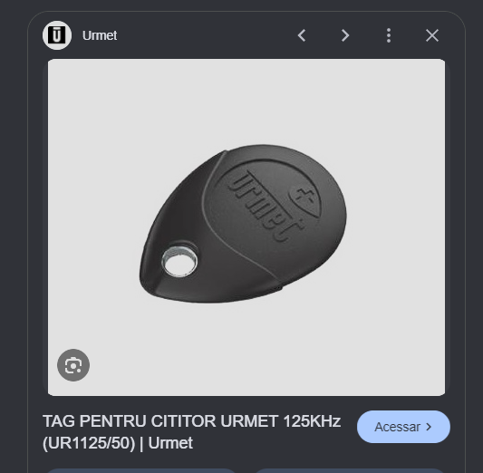
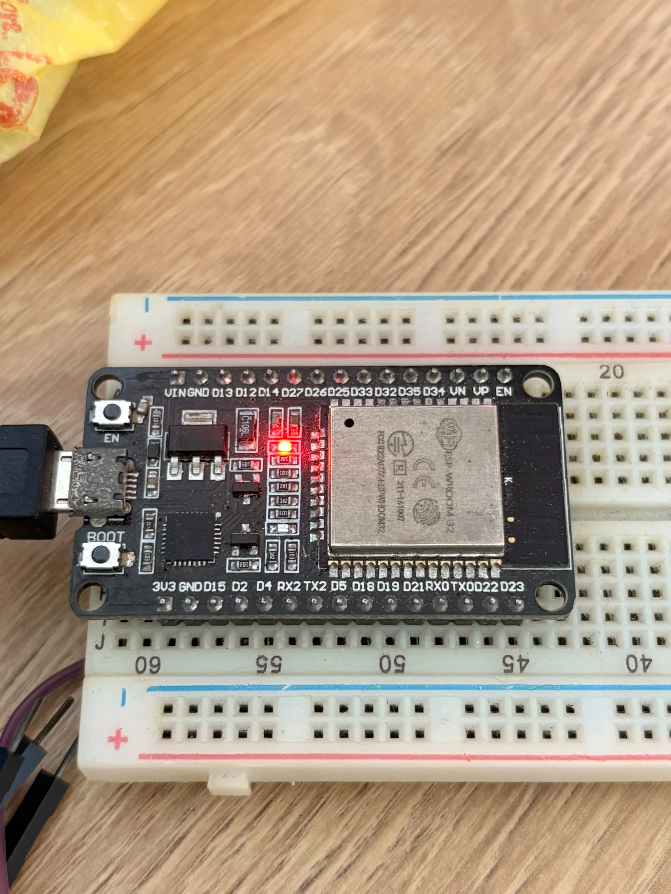
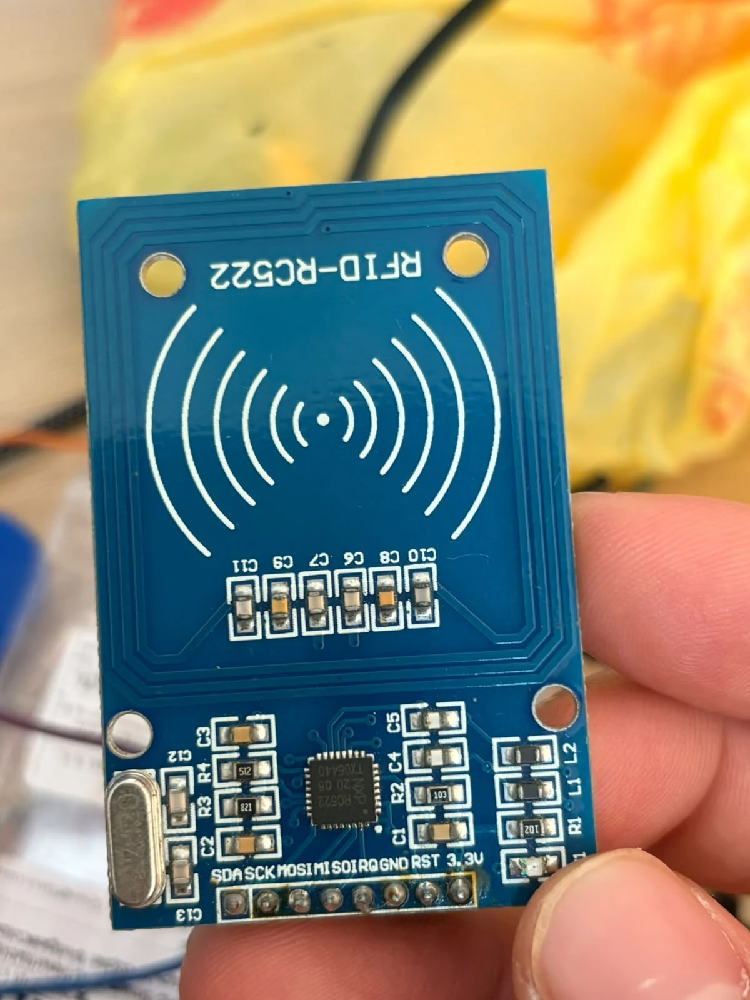

# Clonando uma tag Urmet (MIFARE Classic 1K) com ESP32 + RC522

Projeto academico de leitura, recuperacao de chave e **clonagem** de um keyfob URMET contato sem
contato -- com tags proprias, ambiente controlado e codigo aberto aqui no repo.

-blue)   

> **A foto que quase enganou todo mundo** (o motivo do "haskiada" hehe): o anuncio da tag dizia
> **125 kHz**. Nao e. E MIFARE Classic, `ATQA`/`SAK` de Classic, **13,56 MHz** -- a foto abaixo e
> justamente a que veio com essa especificacao errada.



Fotos do bench: o modulo **ESP32** e o reader **RC522** (SDA/SCL/MOSI/MISO/RST).

| ESP32 do bench | RC522 no bench |
|---|---|
|  |  |

---

## 1. O que e o projeto (e o que nao e)

Uma tag **MIFARE Classic 1K** tem 1024 bytes em **16 setores de 4 blocos**. Cada setor tem duas
chaves de 6 bytes (**KeyA**, **KeyB**) e um trailer com os *access bits*. O dado fica em claro; o
que protege a credencial e a **chave por setor** -- o CRYPTO1 cifra o *enlace* (autenticacao), nao
o conteudo do cartao.

Nesta Urmet especificamente: **a credencial mora na chave do setor, e nao no conteudo dos blocos**
(o dump completo, com os dados da tag original, fica guardado fora do repo).

Duas coisas que este repo **nao** promete:
- nao e ataque a um sistema fechado: o leitor Urmet da catraca so costuma conferir o **UID**;
- nao e clonagem "universal": o bloco 0 de cartao comum e *read-only*, entao migrar o UID exige
  **tag magica** (Gen1a / Gen2-CUID / Gen3).

---

## 2. Ligacao atual (pinos novos, usados por todos os sketches publicados)

| RC522 | ESP32 | Nota |
|---|---|---|
| SDA | `D21` | SPI de software (bit-bang) da lib MFRC522 |
| SCK | `TX2` (GPIO17) | |
| MOSI | `RX2` (GPIO16) | |
| MISO | `D4` | **o pino que mais deu problema** -- fio/contato |
| RST | `3V3` | RC522 com reset fixo em nivel alto |
| IRQ | *nao liga* | a lib faz polling, nao usa a IRQ |
| GND | `GND` | |
| 3.3V | `3V3` | **nunca** VIN (VIN e 5 V e queima o RC522) |

Fios **macho -> femea** (o RC522 tem pinos macho). E o reader fica **no ar, longe do metal**:
metal perto da antena derruba o campo e a leitura cai junto.

---

## 3. Metodologia (o fluxo que fecha o clone)

```text
   tag original Urmet                cartao novo (magico)
   16 setores / 1KB                  bloco 0 = UID      |--> 3. TRAVA (opcional)
   chave por setor     1. LEITURA    bloco 1 = ...      |    7F0788
     (omitida)         dicionario    16 trailers        |
                      de chaves      conhecidas
```

A ordem importa: **o bloco 0 tem de ser gravado antes dos trailers** -- num clone antigo o cartao
ficou com UID de fabrica justamente porque o passo do bloco 0 foi pulado.

### Chave por setor e os trailers

| Trailer | Access bits | O que significa |
|---|---|---|
| trabalho | `FF0780` | grava com KeyA, KeyA nunca alteravel -> **regravavel pra sempre** |
| final | `7F0788` | **trava o setor**: depois disso so a chave certa escreve de novo |

Os *access bits* sao derivados da formula da propria lib (`MIFARE_SetAccessBits`, em
`mfrc522_picc.cpp`): para KeyA gravavel e nunca alteravel, os bits `C21a C21b C10 C10` tem de sair
`0 0 0 1` -- qualquer outra combinacao (ex.: `0 0 8 9`) troca o bit 7 do byte 3 e vira trava
permanente sem avisar.

---

## 4. O "brute force" que cabe num ESP32: dicionario de chaves **conhecidas**

Nao e brute force de 48 bits, e um **ataque de chave conhecida**: o Classic tem poucas chaves em
uso real, entao um dicionario publico bem-populado abre a maioria dos setores. Aqui sao **2505
chaves** (`keys.h`, extraidas do `mfc_default_keys.dic` do firmware Iceman/RRG), e cada setor e
testado **duas vezes por chave** (KeyA e KeyB).

```cpp
    bool tryOne(byte trailer, byte keyType, const byte *k) {
      MFRC522::MIFARE_Key key; memcpy(key.keyByte, k, 6);
      if (rfid.PCD_Authenticate(keyType, trailer, &key, &rfid.uid) != MFRC522::STATUS_OK) { reselect(); return false; }
      // VERIFICA com leitura real do trailer -> glitch nao passa
      byte buf[18]; byte len = 18;
      bool rok = (rfid.MIFARE_Read(trailer, buf, &len) == MFRC522::STATUS_OK);
      rfid.PCD_StopCrypto1();
      if (!rok) { reselect(); return false; }
      return true;
    }
```

Repare no detalhe que evita falso-positivo: **autenticar nao basta** -- o codigo so aceita uma chave
se a autenticacao responder E o `MIFARE_Read` do bloco voltar certo. Uma chave errada as vezes
*aceita* e depois falha na leitura; ler de volta derruba o glitch.

```cpp
    void crack() {
      nCache = 0;
      for (int i = 0; i < NSEED; i++) addCache(SEED[i]);   // pre-carrega chaves conhecidas
      for (int i = 0; i < 16; i++) { hasA[i] = hasB[i] = false; }
      Serial.print("\n===INICIO=== UID:");
      for (byte i = 0; i < rfid.uid.size; i++) Serial.printf(" %02X", rfid.uid.uidByte[i]);
      Serial.println();

      for (byte s = 0; s < 16; s++) {
        byte trailer = s * 4 + 3;
        // 1) chaves ja achadas (cache) para A e B
        for (int c = 0; c < nCache && !hasA[s]; c++)
          if (tryOne(trailer, MFRC522::PICC_CMD_MF_AUTH_KEY_A, cache[c])) { hasA[s]=true; memcpy(foundKeyA[s], cache[c], 6); }
        for (int c = 0; c < nCache && !hasB[s]; c++)
          if (tryOne(trailer, MFRC522::PICC_CMD_MF_AUTH_KEY_B, cache[c])) { hasB[s]=true; memcpy(foundKeyB[s], cache[c], 6); }

        // 2) dicionario completo
        for (int i = 0; i < NKEYS && !hasA[s]; i++) {
          byte k[6]; for (int j = 0; j < 6; j++) k[j] = pgm_read_byte(&KEYS[i][j]);
          if (tryOne(trailer, MFRC522::PICC_CMD_MF_AUTH_KEY_A, k)) { hasA[s]=true; memcpy(foundKeyA[s], k, 6); addCache(k); }
          if ((i & 511) == 511) Serial.printf("  setor %d: testadas %d chaves...\n", s, i + 1);
        }
        for (int i = 0; i < NKEYS && !hasB[s]; i++) {
          byte k[6]; for (int j = 0; j < 6; j++) k[j] = pgm_read_byte(&KEYS[i][j]);
          if (tryOne(trailer, MFRC522::PICC_CMD_MF_AUTH_KEY_B, k)) { hasB[s]=true; memcpy(foundKeyB[s], k, 6); addCache(k); }
        }

        Serial.printf("Setor %2d: ", s);
        if (hasA[s]) { Serial.print("KeyA="); printKey(foundKeyA[s]); } else Serial.print("KeyA=? ");
        if (hasB[s]) { Serial.print("  KeyB="); printKey(foundKeyB[s]); } else Serial.print("  KeyB=?");
```

Tres atalhos honestos no laco acima: (a) o **cache** das chaves ja achadas e testado antes do
dicionario inteiro, (b) todo setor que falha vai para o **rodizio** do fim da lista (um setor
teimoso nao trava os outros 15), (c) `reselect()` segura as **tremidas de fio** -- quando a leitura
cai, re-autentica em vez de desistir.

> No cartao travado, o bloco 0 normalmente so abre com `FF...FF`. Aqui ele abriu com uma chave do
> dicionario (a chave esta omitida deste repo) -> isso e a **prova de integridade** do bloco 0:
> UID, BCC, `SAK` e `ATQA` batendo com o que a tag responde ao vivo.

---

## 5. Os codigos deste repo

| Sketch | O que faz |
|---|---|
| [`code/rc522_dumpkey.ino`](code/rc522_dumpkey.ino) | **LE a tag ORIGINAL** com a chave do setor (omitida) e despeja o dump completo -- a fonte da verdade. |
| [`code/rc522_crack.ino`](code/rc522_crack.ino) | O **ataque de dicionario** acima: 2505 chaves x KeyA/KeyB, cache, verificacao por leitura, keyfile no serial. |
| [`code/rc522_master.ino`](code/rc522_master.ino) | **GRAVA o clone** no cartao novo: bloco 0 (UID) -> bloco 1 -> os 16 trailers -> **trava** em `7F0788` -> verifica tudo. E o principal. |
| [`code/rc522_fixb1.ino`](code/rc522_fixb1.ino) | **LE o clone e compara byte a byte** com o original (16 setores + UID); corrige o bloco 1 se faltar o `01`. |
| [`code/keys_amostra.h`](code/keys_amostra.h) | Amostra do dicionario (as chaves sao publicas/conhecidas -- nao sao segredo). |

*Os `.ino` em `code/` sao as **copias publicadas**: chave do setor, UID e dados dos blocos da tag
original saem substituidos por `KEYA_URMET_OMITIDA` / `UID_OMITIDO` / `MFG_OMITIDO` (`#define` no
topo de cada arquivo). O workspace tem os valores reais.*

Rodar qualquer um e sempre o mesmo comando -- muda so o nome no fim:

```powershell
$env:ARDUINO_DIRECTORIES_DATA="$env:LOCALAPPDATA\Arduino15"
& "C:\Program Files\Arduino CLI\arduino-cli.exe" compile --fqbn esp32:esp32:esp32 --upload -p COM5 rc522_master
```

Monitor pra ver a saida (serve pra todos):

```powershell
& "C:\Program Files\Arduino CLI\arduino-cli.exe" monitor -p COM5 -c baudrate=115200
```

Fluxo tipico: `rc522_dumpkey` (confere a original) -> `rc522_crack` (recupera as chaves) ->
`rc522_master` (grava o cartao novo) -> `rc522_fixb1` (confere o clone bate 100%).

---

## 6. Resultado (com os segredos de fora)

| Item | Valor publicado |
|---|---|
| Tipo de tag | MIFARE Classic 1K (S50), 16 setores x 4 blocos, 1 KB |
| UID | 4 bytes -- *valor omitido* (`UID_OMITIDO`) |
| `SAK` / `ATQA` | `08` / `0400` -> confirma Classic |
| Chave do setor | 6 bytes -- *valor omitido* (`KEYA_URMET_OMITIDA`) |
| Conteudo dos blocos de dado | *omitido* (dump completo fica local) |
| Bloco 1 do setor 0 | tem um byte caracteristico do Urmet -- *omitido*; o clone precisou dele corrigido |
| Trailer de trabalho | `FF0780` (regravavel, grava com KeyA) |
| Trailer final | `7F0788` (setor travado) |
| Setores abertos pelo dicionario | sai no log do `rc522_crack` (`Resumo: N/16 setores`) |

**O que fica fora do repo de proposito:** o `.mct`/`.bin` do dump, o keyfile e os dados dos blocos
da tag original -- porque neles mora a chave (e ela e segredo deste projeto).

---

## 7. Honestidades que o codigo aprendeu da pior forma

- **O gargalo era fisico.** Enquanto o log mostra `sensor caiu -> re-init`, e contato/fio (MISO e
  alimentacao), nao logica: com uma janela boa de ~10 s os 16 setores fecham numa passada so.
- **Preflight com a instrucao certa.** O teste vivo do sensor e o comando que o RC522 *rejeita*
  (`0x92`, invalida) -- ele responde `0x00/0xFF` quando o barramento esta sao e fica **mudo**
  quando o fio cai. Testar com a que ele aceita (`0x78`) ao contrario inverte o diagnostico.
- **NAK nao e fio solto.** Em escrita de bloco 0, NAK/`NOT_AUTHENTICATED` significa *cartao nao e
  magico* (bloco 0 read-only) -- continuar insistindo queima as tentativas como se fosse contato.
- **Nao existe "gravou" sem reler.** Todo trailer so entra na lista de concluidos se autenticar com
  a chave certa **e** o `MIFARE_Read` bater byte a byte com o que foi gravado.

---

## 8. Referencias

1. R. Garcia *et al.* -- *Wireless Traceable Subversion of Protection* (break do MIFARE Classic), ESORICS 2008 / RFC 9143.
2. P. Courtois -- *Security of Cryptographic RFID: Attacks on the CRYPTO1 Cipher*, ACM ICSSAC 2009 (ataques de chave conhecida e recuperacao).
3. T. Meijer & R. Verdult -- *Sleeping Knight Makes the Ends Meet (and Brute Force Unlocks the Rest)*, ACM SIGSAC/CCS 2015 (recuperacao de chave em Classic travado).
4. NXP Semiconductors -- **MFRC522** datasheet (reader 13,56 MHz, SPI/I2C/UART) e **MIFARE MF1S503x / MF1IC50a** data sheet (setores, chaves, access bits).
5. MiguelBalbo -- *MFRC522* para Arduino (`MIFARE_Authentication`, `MIFARE_Write`, `MIFARE_SetAccessBits`).
6. Proxmark3 / RR & Iceman -- dicionario `mfc_default_keys.dic` e a familia de comandos `hf mf chkey|dump|restore`.

---

*Feito como projeto academico: tags proprias, ambiente proprio, clone por pesquisa -- sem reclamar
de ninguem envolvido.*
